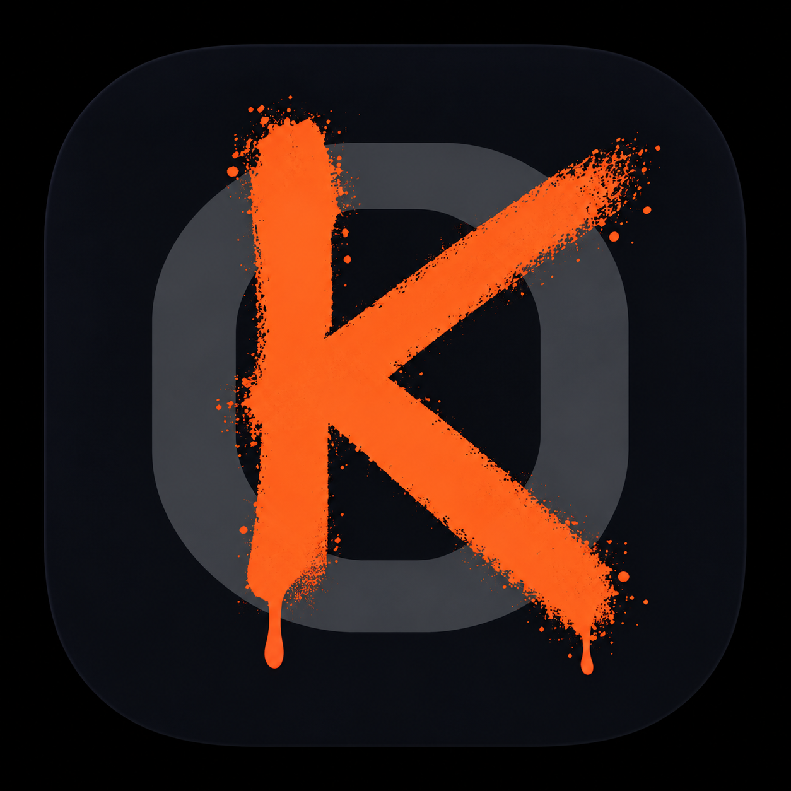
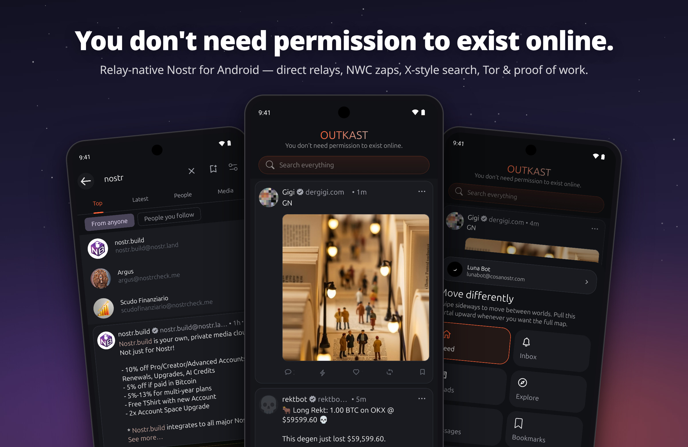
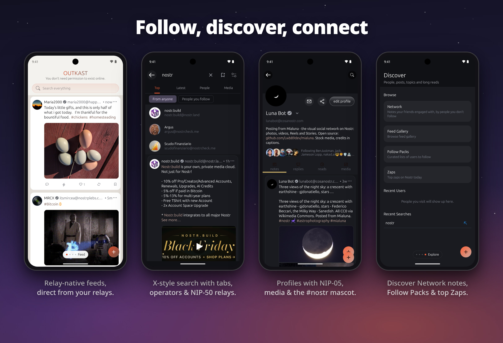
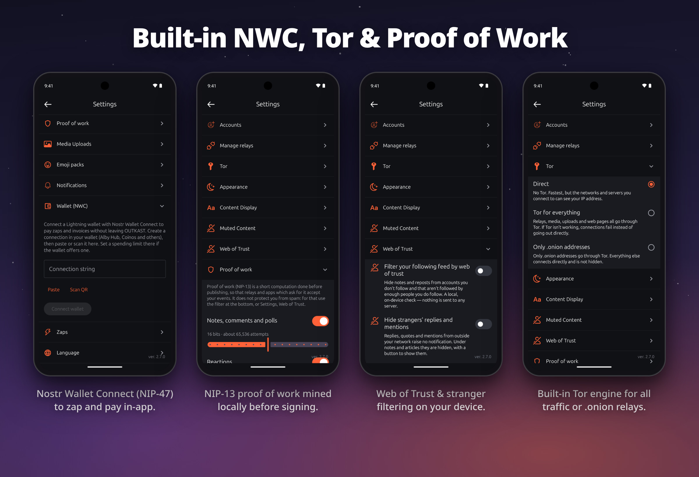
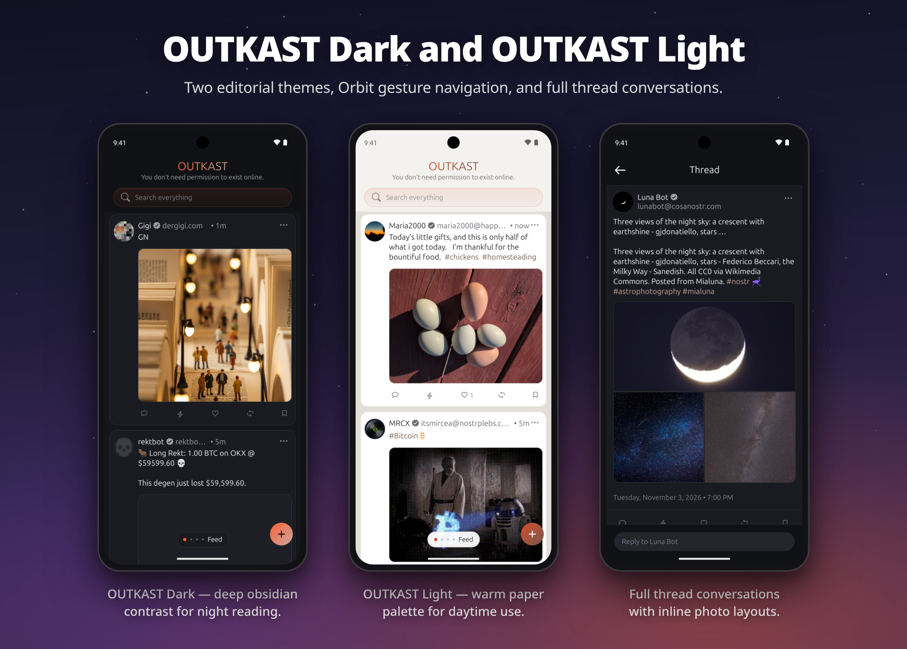

# OUTKAST

<p align="center">
  
</p>

<p align="center">
  <strong>You don't need permission to exist online.</strong><br>
  A social-first, relay-native Nostr client for Android.
</p>

<p align="center">
  <a href="https://github.com/Lwb89dev/outkast/blob/main/LICENSE"></a>
  <a href="https://github.com/Lwb89dev/outkast"></a>
  <a href="https://github.com/Lwb89dev/outkast/releases/tag/v2.7.0"></a>
</p>

OUTKAST is an independent social client built from the LibreNostr and [Primal Android](https://github.com/PrimalHQ/primal-android-app) foundations. It keeps the mature Android/Compose and protocol layers while presenting a simpler product organized around **Orbit** navigation (`Feed`, `Inbox`, `Reads`, `Explore`, `Messages`, `Bookmarks`, `You` and `Settings`).

<p align="center">
  
</p>

The architecture is:

```text
client  <->  Nostr relays  +  local Room/DataStore
```

The imported codebase still contains some upstream namespaces and compatibility packages, which are being cleaned up incrementally without breaking in-place upgrades.

The current release is [`v2.7.0`](https://github.com/Lwb89dev/outkast/releases/tag/v2.7.0). Release APKs
are signed, `arm64-v8a` only, and published from the [`altRelease`](https://github.com/Lwb89dev/outkast/releases)
build variant on GitHub Releases and Zapstore.

## Screenshots

<p align="center">
  
</p>
<p align="center">
  
</p>
<p align="center">
  
</p>

## Current state

**100% of active Android data paths are relay-native.** Feeds, profiles, threads,
notifications, direct messages, search, bookmarks, mute lists, articles and
zaps are all read and written directly against Nostr relays; no Primal cache
or aggregation server is used for any of them. Full detail and
verification evidence: [`docs/RELAY_ONLY_MIGRATION_STATUS.md`](docs/RELAY_ONLY_MIGRATION_STATUS.md)
and [`docs/SECURITY_AUDIT.md`](docs/SECURITY_AUDIT.md).

- **Direct relay networking**: `RelayPool` read/write with EOSE handling, timeouts, deduplication, outbox/NIP-65 relay lists and clean subscription shutdown.
- **Relay-native feeds & content**: **Latest** and **Latest with replies** feeds, **NIP-68** picture notes (kind 20), profiles, follow lists, threads, notifications, **Reads** (NIP-22/NIP-23 articles and NIP-84 highlights), **Explore** (Network, Feed Gallery, Follow Packs, trending topics & top zaps), polls (kind 1068/6969/1018) and live-stream lookup.
- **Encrypted direct messages**: **NIP-17** gift-wrapped messages (NIP-44) with NIP-04 fallback.
- **X-style search & NIP-50 relays**: `Top`, `Latest`, `People` and `Media` tabs, `From anyone` / `People you follow` scope, live suggestions, persistent recent searches & users, advanced search form, and operators (`"exact phrase"`, `OR`, `-word`, `#hashtag`, `@name`, `from:`, `to:`, `since:`, `until:`, `filter:media`, `filter:links`, `-filter:replies`, `min_faves:`, `min_replies:`, `min_retweets:`), querying NIP-50 full-text relays (`search.nos.today`, `relay.ditto.pub`, `nostr.wine`).
- **Nostr Wallet Connect (NIP-47) & zaps**: connect an external Lightning wallet in Settings → Wallet (NWC) to pay zaps and invoices in-app with explicit amount confirmation and Android Keystore per-account encryption; falls back to external `lightning:` wallet intents when no NWC wallet is connected.
- **Proof of work (NIP-13)**: on by default (16 bits for notes, comments and polls; 12 bits for reactions and direct messages), cancellable while keeping the draft, and configurable per event kind.
- **Web of Trust & stranger filtering**: optional local Web of Trust and Proof of Work filters for replies, quotes, mentions and notifications, computed on-device without sending lists to any server.
- **Media, composer & reactions**: attachments, Blossom uploads, photo editor with built-in **Draw** tool, polls, GIF picker (`gifs.nostr.build` with GIFverse fallback), **NIP-30** custom emoji packs & reactions, keyboard/scrollable emoji picker, and the bundled running-ostrich mascot for `#nostr` / `#grownostr` / `#asknostr`.
- **Orbit, multi-account & Deck mode**: **Orbit** bottom portal with one-tap profile switching; **OUTKAST Dark** and **OUTKAST Light** themes; multi-column **Deck mode** on landscape tablets; `nostr:` (`npub`, `nprofile`, `note`, `nevent`, `naddr`) and `nostrich.org/p/<npub>` deep links.
- **Local security**: Android Keystore AES-GCM credential storage, Amber (NIP-55) and bunker (NIP-46) signing, disabled Android backups, and HTTPS-only / cleartext-disabled networking; legacy centralized wallet, Breez/Spark and Primal Premium modules have been removed.

The Android `applicationId` and module `namespace` are both `com.librenostr.android` so signed OUTKAST releases update existing LibreNostr installations in place without losing identities, databases, relay settings, wallet connections or Android Keystore material, while matching the package declared in the source tree. Internal Kotlin source packages remain under `net.primal.android.*` so Android component class names and Room/DataStore persistence stay stable.

### Network routing and Tor

OUTKAST supports three network modes:

| Mode | Behavior |
|---|---|
| Direct | Tor is off and connections use the ordinary network path. |
| Tor for everything | All supported connections use Tor. If Tor is unavailable, the connection fails instead of falling back to a direct path. |
| Only `.onion` addresses | `.onion` destinations use Tor; clearnet destinations remain direct and are not hidden. |

When a Tor mode is selected, relay WebSockets, HTTP requests, media, uploads and web pages follow
the selected route. Relay connections are re-established when the mode changes, and destinations
that must use Tor are never resolved or fetched directly.

Tor can run through either the external Orbot SOCKS proxy or the built-in Arti engine. Built-in Tor
is bundled as a native `arm64-v8a` library, so no additional app is required. The Android build is
therefore distributed as an `arm64-v8a` split only.

## Remaining boundaries

OUTKAST still carries structural naming inherited from upstream:

- some upstream class, package and module names (e.g. `core/networking-primal`, `domain/primal`, `net.primal.android.*`) remain in the tree to preserve component class names and local persistence across upgrades;
- historical test fixtures and event text may still reference the upstream domain; these are not live endpoints.

Remaining cleanup and phased work are tracked in [`docs/LIBRENOSTR_ROADMAP.md`](docs/LIBRENOSTR_ROADMAP.md).

## Project layout

| Directory | Role |
|---|---|
| `app/` | Android application, Compose screens, navigation and feature wiring |
| `core/` | Networking, caching, media, cryptography and shared UI primitives |
| `data/` | Local databases (`CachingDatabase` v8, `AccountDatabase`), remote APIs, NWC client (`remote-nwc`) and repositories |
| `domain/` | Platform-independent Nostr, NIP-13 PoW, WoT, feed, profile and account models |
| `detekt-rules/` | Custom static analysis rules (`PrimalRuleSet`) |
| `tools/arti-build/` | Pinned Rust/Arti JNI wrapper build and reproducibility scripts for built-in Tor |
| `docs/` | Architecture notes, migration status, security audits and framed release screenshots |

## Building

Requires **JDK 21** and an Android SDK with **compile SDK 37** (target SDK 36, min SDK 26). The project uses **AGP 9.2.1** and **Kotlin 2.4.0**.
The Android application is packaged for `arm64-v8a` only. The built-in Tor native library (`libnostr_arti.so`) is already
committed under `app/src/main/jniLibs/arm64-v8a/`; rebuilding it separately requires the pinned toolchain
documented in [`tools/arti-build/README.md`](tools/arti-build/README.md).

There is a single build: OUTKAST ships without Google Play services, Play Billing, ML Kit or Firebase, so there is no flavor dimension.

```bash
export JAVA_HOME=/usr/lib/jvm/java-21-openjdk-amd64   # or another JDK 21 path
export ANDROID_HOME="$HOME/Android/Sdk"

# sdk.dir is written to gitignored local.properties
echo "sdk.dir=$ANDROID_HOME" > local.properties

./gradlew :app:compileDebugKotlin
./gradlew :app:assembleDebug
./gradlew :app:installDebug
```

Debug builds do not encrypt stored keys (`NoEncryption`); do not use a debug APK with a valuable real `nsec`.

### Release builds

Create a gitignored `config.properties` in the repository root with the `alternative` signing
properties. The keystore itself must stay outside Git:

```properties
alternative.storeFile=/path/to/librenostr-release.jks
alternative.storePassword={KeystorePassword}
alternative.keyAlias={KeyAlias}
alternative.keyPassword={KeyPassword}
```

Optional properties `localStorage.keyAlias` and `nostrBuildGifApiKey` can also be supplied in `config.properties` (without `nostrBuildGifApiKey`, GIF search falls back to GIFverse if `gifs.nostr.build` refuses unauthenticated requests). Build and install the signed release with:

```bash
./gradlew :app:assembleAltRelease -Plibrenostr.requireBuiltInTor=true --no-daemon
./gradlew :app:installAltRelease --no-daemon
```

The APK is written to
`app/build/outputs/apk/altRelease/outkast-<version>-arm64-v8a.apk`.

## Releases

Signed release APKs (`altRelease`, `arm64-v8a` only) are published on the
[GitHub Releases](https://github.com/Lwb89dev/outkast/releases) page (alongside `SHA256SUMS.txt`) and on
**Zapstore** via [`zapstore.yaml`](zapstore.yaml). The latest release is
[`v2.7.0`](https://github.com/Lwb89dev/outkast/releases/tag/v2.7.0). Verify the APK checksum and signature
before installing:

```bash
sha256sum -c SHA256SUMS.txt
apksigner verify --print-certs outkast-<version>-arm64-v8a.apk
```

## Documentation

| File | Description |
|---|---|
| [`CHANGELOG.md`](CHANGELOG.md) | English release history |
| [`built_in_tor.md`](built_in_tor.md) | Built-in Tor design, implementation status and verification notes |
| [`docs/UPSTREAM.md`](docs/UPSTREAM.md) | Origin, remotes and MIT obligations |
| [`docs/OUTKAST_MIGRATION.md`](docs/OUTKAST_MIGRATION.md) | Upgrade contract, feature-preservation matrix and regression plan |
| [`docs/BASELINE.md`](docs/BASELINE.md) | Toolchain and imported baseline |
| [`docs/ARCHITECTURE_UPSTREAM.md`](docs/ARCHITECTURE_UPSTREAM.md) | KEEP / REFACTOR / REPLACE / REMOVE map |
| [`docs/PRIMAL_SERVER_DEPENDENCIES.md`](docs/PRIMAL_SERVER_DEPENDENCIES.md) | Inventory of remaining server verbs |
| [`docs/LIBRENOSTR_ROADMAP.md`](docs/LIBRENOSTR_ROADMAP.md) | Migration phases and stop conditions |
| [`docs/LIBRENOSTR_BACKLOG.md`](docs/LIBRENOSTR_BACKLOG.md) | Atomic implementation tasks |
| [`docs/RELAY_ONLY_MIGRATION_STATUS.md`](docs/RELAY_ONLY_MIGRATION_STATUS.md) | Relay-only migration status per data path |
| [`docs/SECURITY_AUDIT.md`](docs/SECURITY_AUDIT.md) | Security and relay-only audit results and verification evidence |

## Git remotes

```text
origin    https://github.com/Lwb89dev/outkast.git
upstream  https://github.com/PrimalHQ/primal-android-app.git   (fetch only)
```

Do not push to `upstream`.

## Contributing

Open issues and pull requests on this repository. Discuss non-trivial changes
first, and check [`docs/LIBRENOSTR_ROADMAP.md`](docs/LIBRENOSTR_ROADMAP.md)
and [`docs/LIBRENOSTR_BACKLOG.md`](docs/LIBRENOSTR_BACKLOG.md) for the current
migration phase before starting work on the networking layer.

## License

MIT. Upstream copyright: Copyright (c) 2023 PRIMAL SYSTEMS INC. See [LICENSE](LICENSE). OUTKAST preserves attribution for LibreNostr and all unmodified upstream code.

## Acknowledgments

- [Upstream Android client](https://github.com/PrimalHQ/primal-android-app) — the client this fork starts from
- [Quartz](https://github.com/vitorpamplona/quartz) — Nostr protocol & NIP-04 / NIP-44 cryptography
- [Acinq](https://acinq.co) — secp256k1 and Lightning foundations
- [Arti](https://gitlab.torproject.org/tpo/core/arti) — Tor Project's Rust Tor implementation powering built-in Tor
